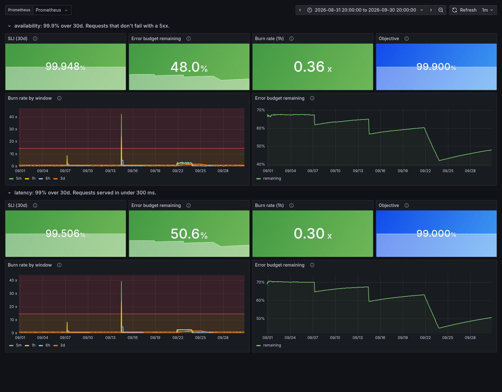
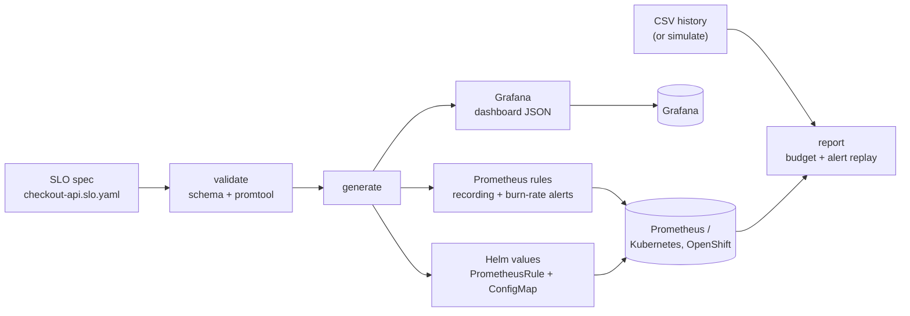
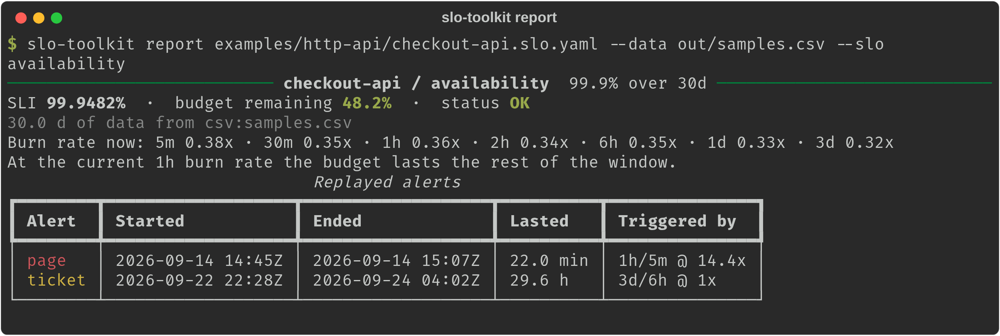
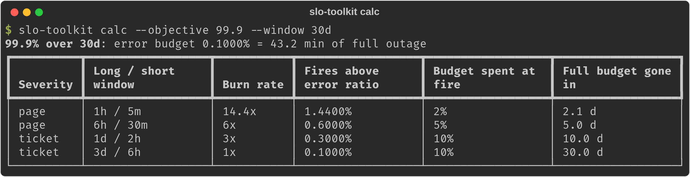

# slo-toolkit

[](https://github.com/mahidhar-salla/slo-toolkit/actions/workflows/ci.yml)
[](LICENSE)


**Write an SLO once in YAML. Get error-budget math, multi-window burn-rate alerts for Prometheus, a Grafana dashboard and a budget report, all generated from that one file.**

**What this shows**

- **The problem:** alerts that page on noise, and reliability targets that live in a slide deck instead of in the monitoring. Here the spec is the single source of truth, so rules, dashboards and reports can't drift apart.
- **The SRE skill:** SLI/SLO design, error budgets and multi-window, multi-burn-rate alerting from the [Google SRE Workbook](https://sre.google/workbook/alerting-on-slos/), checked with `promtool` unit tests and replayed against 30 days of synthetic traffic.
- **The business impact:** people get paged only when customers are being hurt fast enough to threaten the objective, and product owners get one plain number (budget left) to weigh releases against reliability work.


<sub>The generated dashboard on 30 days of synthetic data: a short blip on 09/07 (no page), a 40-minute outage on 09/14 (paged), and a two-day slow burn from 09/22 (ticket).</sub>



## Quick start

Needs Python 3.11+ and `make`. No Docker required.

```bash
git clone https://github.com/mahidhar-salla/slo-toolkit && cd slo-toolkit
make demo
```

`make demo` installs into a local `.venv`, then validates the example spec, generates rules, a dashboard and Helm values, simulates 30 days of traffic and prints a budget report with a replay of which alerts would have fired:



Or install the CLI on its own:

```bash
pipx install git+https://github.com/mahidhar-salla/slo-toolkit
slo-toolkit calc --objective 99.9 --window 30d
```



## The spec

```yaml
apiVersion: slo-toolkit/v1
service: checkout-api
owner: payments-platform
slos:
  - name: availability
    description: Requests that don't fail with a 5xx.
    objective: 99.9          # percent
    window: 30d
    sli:
      bad:   sum(rate(http_requests_total{job="checkout-api",code=~"5.."}[{{window}}]))
      total: sum(rate(http_requests_total{job="checkout-api"}[{{window}}]))
    alerting:
      runbook_url: https://example.com/runbooks/error-budget-burn
```

Use `good` or `bad` (one of them) over `total`. `{{window}}` is replaced with each alerting window. Labels, alert routing and the alert policy are optional; see [`examples/`](examples/).

## Commands

| Command | What it does |
|---|---|
| `slo-toolkit calc` | Budget, allowed downtime and alert thresholds for an objective and window |
| `slo-toolkit validate <spec>... [--promtool]` | Schema check, warnings for objectives the alerts can't defend, optional `promtool check rules` |
| `slo-toolkit generate <spec> [-o out] [--helm-values]` | `<service>.rules.yaml`, `<service>.dashboard.json`, and values for the Helm chart |
| `slo-toolkit report <spec> --data file.csv` | SLI, budget left, burn rate per window, and a replay of page/ticket alerts over the history |
| `slo-toolkit report <spec> --prometheus-url URL` | Same numbers from a live Prometheus (queries the raw SLI, so it works before the rules are deployed) |
| `slo-toolkit simulate <spec>` | Deterministic synthetic traffic for demos and testing |

`report` prints text, Markdown (`-f markdown`, handy for a weekly review or a ticket) or JSON, and exits with code 3 when an SLO is already missed, so it can gate a pipeline.

## How the alerts work

Each SLO gets recording rules for the error ratio over 5m, 30m, 1h, 2h, 6h, 1d and 3d, plus two alerts. An alert fires only when **both** a long and a short window are burning budget too fast: the long window proves it matters, the short one proves it is still happening, so the alert clears within minutes of recovery.

| Severity | Long / short window | Budget spent when it fires | Burn rate (30d window) |
|---|---|---|---|
| page | 1h / 5m | 2% | 14.4x |
| page | 6h / 30m | 5% | 6x |
| ticket | 1d / 2h | 10% | 3x |
| ticket | 3d / 6h | 10% | 1x |

These are the workbook's recommended starting points (Table 5-8, plus the 1d/2h ticket step from its example configuration; `profile: workbook-table` uses only the three table rows). Burn rates are derived from "share of budget spent", so a 28d window gets 13.44x instead of a hard-coded 14.4x. Generated rules come with `promtool` unit tests in [`tests/promtool/`](tests/promtool/), including one that checks the page clears once errors stop. There's a short [runbook](docs/runbooks/error-budget-burn.md) for the alerts too.

## Run it against real Prometheus and Grafana

```bash
make stack-up   # synthetic service + Prometheus (generated rules) + Grafana (generated dashboard)
make chaos      # inject 20% errors for 10 minutes; the page alert fires within a minute or two
make stack-down
```

Grafana is on http://localhost:3000 and Prometheus alerts on http://localhost:9090/alerts. The demo service is a few lines of standard-library Python with a `/chaos` endpoint for failure injection. No Docker? `scripts/local-stack.sh` runs the same stack from local `prometheus` and `grafana` binaries.

## Deploy to Kubernetes

```bash
slo-toolkit generate examples/http-api/checkout-api.slo.yaml -o out --helm-values
helm install checkout-api-slo charts/slo-rules -f out/checkout-api.values.yaml -n monitoring
```

The chart creates a `PrometheusRule` (for prometheus-operator / kube-prometheus-stack) and a dashboard `ConfigMap` labelled for the Grafana sidecar. OpenShift's user-workload monitoring also reads `PrometheusRule` objects; that path hasn't been tested here yet.

## Examples

| Example | SLIs | Shows |
|---|---|---|
| [`http-api`](examples/http-api/) | availability (5xx), latency (< 300 ms) | `bad` and `good` forms, runbook links |
| [`grpc-api`](examples/grpc-api/) | availability by gRPC code | 28d window, custom severity labels |
| [`batch-job`](examples/batch-job/) | run success, data freshness | low-volume SLIs, `workbook-table` profile |
| [`kafka-consumer`](examples/kafka-consumer/) | minutes with lag under a threshold | time-based SLI from a gauge |

Generated output for each is committed under `examples/*/out/`, and CI fails if it goes stale.

## How it compares

[Sloth](https://github.com/slok/sloth) and [Pyrra](https://github.com/pyrra-dev/pyrra) are the established tools here, and if you run Kubernetes at scale you probably want one of them: Sloth has an operator, SLI plugins and OpenSLO support; Pyrra has a UI and an operator. slo-toolkit is smaller and aimed at a different moment:

- **Before you commit to alerting:** `calc` and `report --data` let you test an objective against history and see which alerts would have fired, without deploying anything.
- **Python and plain files:** a `pip install`, no cluster needed, easy to read and change.
- **The numbers people ask for:** a budget report in text, Markdown or JSON for reviews and pipelines.

It generates the same style of multiwindow, multi-burn-rate rules, so moving to Sloth or Pyrra later is straightforward.

## Why I built this

I'm a Senior Site Reliability Engineer, and much of my recent work has been with a large US auto-finance lender, helping application and business teams adopt SLIs, SLOs and error budgets and making alerting actionable on customer-facing services. The ideas are well documented. The friction is in the mechanics: getting the burn-rate math right, keeping rules and dashboards in step with the targets, and showing a business owner where the budget went this month.

This is the small, open version of that toolkit, written from scratch. It contains no employer or client code, configuration or data; every example and number in this repo is synthetic.

## Limitations

- Ratio SLIs only; latency uses a histogram bucket query you write yourself (see the roadmap).
- Low-traffic services can page on a handful of errors; the workbook's advice (synthetic traffic, aggregation, or a lower objective) still applies.
- `report --prometheus-url` shows current state only; history replay needs CSV data.

See [ROADMAP.md](ROADMAP.md) for what's next.

## Development

```bash
make install     # .venv with dev tools
make ci          # ruff, mypy, pytest, promtool check + test, helm lint/template
make examples    # regenerate committed example output
```

See [CONTRIBUTING.md](CONTRIBUTING.md) and [CHANGELOG.md](CHANGELOG.md).

## References

- Google SRE Workbook, [Alerting on SLOs](https://sre.google/workbook/alerting-on-slos/) and [Implementing SLOs](https://sre.google/workbook/implementing-slos/)
- Prometheus: [recording rules](https://prometheus.io/docs/prometheus/latest/configuration/recording_rules/), [unit testing rules](https://prometheus.io/docs/prometheus/latest/configuration/unit_testing_rules/)

## License

[MIT](LICENSE) © 2026 Mahidhar Chowdhary Salla
